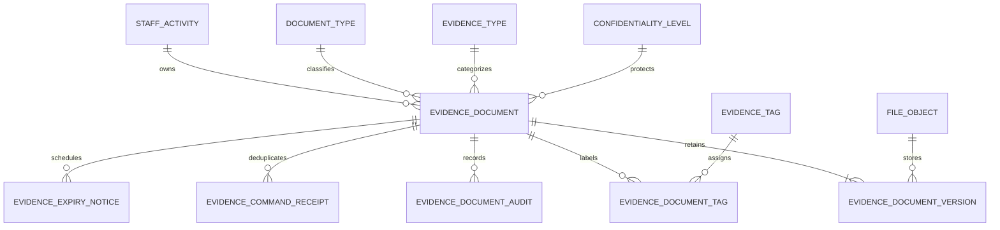
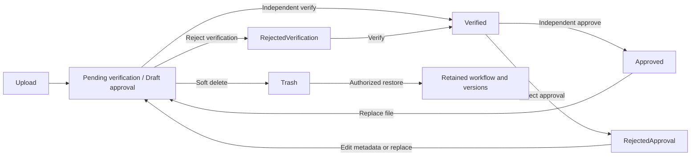

# M33 Centralized Evidence Document Management

M32 was completed before this module. M33 implements the 32-prompt pack in the existing Django/DRF and React/MUI application. The original DOCX and consolidated SQL are unchanged. Runtime is disabled; deployment activation is a separate operational step. See M33_VERIFICATION.json for measured checks and M33_TRACEABILITY.json for prompt mapping.

## Delivered behavior

Staff activities can own centrally managed evidence with searchable metadata, controlled tags, confidentiality, issue/expiry dates, independent verification and approval, immutable file versions, audited private preview/download, soft deletion and authorized restoration. Replacement always resets verification to PENDING and approval to DRAFT. Old files remain available to authorized history readers. Metadata edits are limited to draft/rejected records and invalidate old verification. Files use the existing M13 private storage and required scanner contract. No new public file URLs or raw storage keys are exposed.

The React workspace is `#/evidence`; staff profile pages link to it with an employee filter. It provides responsive lists, filters, metadata/upload forms, replacement, workflow, history, audit, trash, reports, exports and tag administration. Choices and lists are paginated. Drafts stay in memory. Offline mutation and binary controls are disabled. The established React frontend intentionally replaces the prompt's server-template presentation; a non-saving Django metadata form is available for integrations, which must call the services for authorization and persistence.

## Schema and integration

Five source tables: evidence_document, evidence_document_version, evidence_tag, evidence_document_tag, evidence_document_audit. Shared EvidenceType and ConfidentialityLevel masters are in staff_profile. Two platform tables hold idempotency/import provenance and expiry outbox state. The tag link preserves its composite primary key. Native CHECKs, foreign keys, audit ENUM and timestamps are installed through frozen migrations; ORM state is checked for drift.

Compatibility exception: the existing user_account primary key is signed BIGINT. Only M33 user foreign keys use signed BIGINT to match it; other source keys retain unsigned types. A generated nullable current_document_id and unique index enforce at most one current version. Parent locking, optimistic tokens and service validation enforce exactly one at command boundaries. Native triggers forbid version deletion and changes other than current-version demotion, and forbid audit updates/deletes. Source columns are inventoried in M33_SCHEMA_INVENTORY.json. Source installation refuses existing-table adoption; migration reversal refuses populated evidence/history/platform state.

## API contract

All paths below start `/api/v1/evidence/`. Authenticated session/JWT and the existing CSRF policy apply. IDs are strings in JSON reads to preserve BIGINT precision. Unknown writable fields are rejected; actor/status/timestamp/version pointers are service-owned. Reads use the project's bounded pagination. Successful binary responses are private, no-store, nosniff and sandboxed. Error responses include a private correlation ID, with unavailable documents returning 404.

| Path | Method and input |
| --- | --- |
| documents/ | GET scoped list; POST multipart `metadata` JSON and `file` |
| documents/{id}/ | GET detail and optimistic `version`; PATCH `{metadata, version}` |
| documents/{id}/replace-file/ | POST multipart `file`, `change_reason`, `version` |
| documents/{id}/verify/, reject-verification/, approve/, reject-approval/ | POST `{remarks, version}` |
| documents/{id}/workflow/ | POST `{action, remarks, version}` |
| documents/{id}/soft-delete/, restore/ | POST `{reason, version}` |
| documents/{id}/versions/, audit/ | GET authorized paginated history |
| documents/{id}/download/, preview/ | GET current binary through authorization proxy |
| documents/{id}/versions/{number}/download/, preview/ | GET historical binary with history rights |
| documents/summary/, export/ | GET scoped aggregate report / bounded streaming CSV |
| lookups/, lookups/{name}/ | GET capabilities / bounded active choices |
| tags/, tags/{id}/ | Governed GET/POST/PATCH; no hard delete |

POST creation, replacement, workflow, deletion and restore require `Idempotency-Key` (1-100 ASCII characters). Reuse the key for the same ambiguous retry; changing the body under that key gives 409. PATCH uses an optimistic token without a receipt. Stale tokens give 409: refresh and review before resubmission. Keys are scoped to the actor and replays reauthorize current access.

Metadata accepts document_type_id, evidence_type_id, confidentiality_level_id, document_title, description, academic_year_id, document_issue_date, issuing_authority, issuing_organization_id, certificate_document_number, expiry_date and tags. Creation additionally requires staff_activity_id. List filters cover parent/employee/department, type, year, issuer, classification, status, tags, creator, issue/expiry dates, expiry queues and deleted state. Reports include status/type/year/classification/expiry/version/access totals and activity/type coverage. No institutional mandatory-document rule is invented: coverage is descriptive, not a compliance certification. CSV formula prefixes are escaped; exports stop at 10,000 rows.

## Authorization and confidentiality

Run `manage.py seed_evidence` after the M15 catalogue and migrations. This creates 19 permission records and required workflow/classification catalogues, with no role grants. Grant institutional roles deliberately through M15. Scope includes GLOBAL, INSTITUTION, CAMPUS, DEPARTMENT and SELF; explicit DENY wins. There is no M33 superuser bypass.

DOCUMENT.READ gates metadata; DOCUMENT.CREATE/UPDATE/DELETE/VERIFY/APPROVE/EXPORT authorize actions. FILE.CREATE/UPDATE/READ are separate. HISTORY.READ and AUDIT.READ protect retained versions and audit. TRASH.READ/UPDATE control deleted records and restore. TAG.UPDATE is global catalogue administration. CLASSIFICATION.UPDATE is required to change confidentiality. Nonpublic levels additionally need LEVEL_RESTRICTED.READ, LEVEL_CONFIDENTIAL.READ or LEVEL_HIGHLY_RESTRICTED.READ. Unknown/inactive levels deny access.

Binary actions additionally require the established M13 institution allowlist, institution membership/file permissions and the immutable FileObject's confidentiality. Lowering document classification does not lower a previous file's protection. Creator, uploader and activity subject cannot verify by default; approval always requires an independent actor. Metadata-only reviewers can verify without binary privileges, according to assigned institutional policy.

## Configuration and activation

Defaults: SIMS_EVIDENCE_ENABLED=0; SIMS_EVIDENCE_ALLOW_SELF_VERIFY=0; SIMS_EVIDENCE_REQUIRE_VERIFIED_APPROVAL=1; SIMS_EVIDENCE_NOTIFICATION_HANDLER empty. EVIDENCE_EXPIRY_THRESHOLDS=(90,60,30,7,0), EVIDENCE_REQUIRED_EXPIRY_TYPES=() and EVIDENCE_CLASSIFICATIONS are Python settings for reviewed institutional policy. Request throttle defaults 120/min. M13 and both M15 runtime/security flags must be enabled for operation.

Reuse DOCUMENTS_MAX_BYTES (10 MiB), DOCUMENTS_ALLOWED_MIMES (PDF/PNG/JPEG), DOCUMENTS_STORAGE_ROOT, DOCUMENTS_STORAGE_FACTORY, DOCUMENTS_MALWARE_SCANNER. Check the exact existing M13 settings before deployment. Scanning is mandatory in the M13 upload validator and is synchronous and fails closed: unknown/infected/unscannable uploads never become accessible files. No accessible pending/quarantine state is introduced. Office documents, executables and archives remain unsupported by this hardened profile. Do not add extensions without matching content validation, scanner and preview controls.

Local private storage is implemented; the existing storage factory contract supports provider substitution. No concrete S3 adapter, cloud bucket or production scanner was deployed. A production adapter must provide private exclusive writes, read/seek, existence and deletion behavior compatible with M13, and return its stable provider identifier. Use encrypted private storage outside static/media web roots, TLS, least-privilege credentials, restricted logs and backups. Never use the test clean scanner in production.

Activation checklist: back up DB/files; review native schema inventory and migration plan; migrate; seed without grants; configure scanner and private storage; test clean, infected, malformed and scanner-outage cases; assign least-privilege scopes and independent reviewer roles; run evidence_health; test the full lifecycle with two staff roles; verify no-store/no service-worker caching on real devices; review representative-volume query plans; then enable the runtime flag under the institution's release process.

## Expiry job and imports

`manage.py evidence_expiry --actor-id ID --as-of YYYY-MM-DD --limit 500 --after-id 0` is a dry-run. `--apply` creates/reconciles outbox rows. Follow next_after_id until the batch is exhausted; run a fresh scan from zero on later schedules to retry undelivered rows. No delivery occurs without a configured adapter. The adapter receives only stable event/document/actor IDs and threshold. It must deduplicate event_id, resolve current authorized recipients and avoid sensitive content. Outbox creation commits before attempted delivery; adapter exceptions retain retryable state. There is no scheduler or outbound integration enabled by this change.

`manage.py import_evidence --help` documents the manifest/root/namespace/actor flags; default is dry-run. Manifest JSON is bounded to 256 KiB and 200 rows. Each row uses source_id, path and metadata; optional original_timestamps and original_status are retained as receipt provenance. Files must resolve within the explicit root, pass all ordinary scanner/content policies and map to an authorized live staff activity. Dry-run reports valid, already_imported and failed rows without business writes. `--apply` commits each validated row through the same idempotent creation command. Identical source rows replay; changed source IDs/body content conflict. Original approved status never bypasses fresh PENDING/DRAFT review. Keep the reconciliation JSON with the import batch; correct failed source mappings and rerun. Do not delete history to undo a batch.

## Security review and operations

| Threat/failure | Control and operational implication |
| --- | --- |
| ID enumeration / cross-scope access | Scope and classification before reads, counts, reports and binary access; 404 for unavailable IDs; separate denied audit |
| Malicious or disguised file | Bounded content inspection, strict MIME/signature/extension match, mandatory scanner, private UUID storage |
| Stored script / CSV injection | React escaping, restricted preview types/CSP, CSV formula escaping |
| Concurrent replacement / stale approvals | Parent lock, unique current guard, optimistic token, immutable history, unconditional workflow reset |
| Partial storage failure | New object cleanup on failed DB/audit command; no overwrite; checksum/size verification before download |
| History/audit tampering | ORM append-only rules and native triggers; database administrators remain a privileged trust boundary |
| Confidential cache/log leak | NetworkOnly authenticated API, static-only PWA precache, memory-only drafts, no-store binaries, redacted operational logs |
| Notification retries | Durable outbox plus required adapter event deduplication; permissions rechecked before each attempt |
| Legacy privilege laundering | Authoritative audit not backdated; original status/timestamps only provenance; fresh verification |

`manage.py evidence_health` checks current-version invariants and reports runtime/scanner/provider/adapter configuration without exposing paths or secrets. It does not prove scanner service health or object-store availability. Use the sims.evidence logger's request ID/action/status/duration for restricted dashboards; alert on invariant failures, repeated 5xx, scanner/provider failures, elevated denials and undelivered outbox age. Do not put document metadata, file contents, credentials or private keys in telemetry.

On 409 refresh detail and review the current version. On 404 check live activity, scope, classification and file-level permissions without revealing another user's record. On upload rejection review allowed MIME/size/scanner health. On integrity failure suspend affected access and compare the object against protected backups; do not silently rewrite historical FileObjects. Audit write failures intentionally abort mutation/file delivery. Application exceptions cannot clean up an object if the process is killed after storage write and before cleanup; reconcile unreferenced private keys against DB references under an approved retention procedure, never blind bucket deletion.

Retain deleted documents, all file versions, audit and import receipts by default; no automatic purge exists. Define institutional/legal retention and holds before adding any purge job. For backup/DR, pause writes or take a coordinated DB snapshot and versioned object snapshot, preserve scanner/provider configuration separately, encrypt and restrict backups, restore into an isolated environment, check foreign keys and current-version invariants, compare sampled/full object checksums, verify historical download and authorization, and record RPO/RTO. The actual restore rehearsal and institutional retention sign-off remain release gates.

Rollback: disable runtime and expiry scheduling first; keep installed tables and private objects. Use a forward fix for populated databases. Reverse migrations are guarded and intended only for empty installations. Never drop populated evidence/audit to revert application code.

## Verification and remaining release gates

Final local checks: 724 backend tests and 171 subtests passed (including 19 M33 tests and 8 M33 subtests). Frontend coverage totals 130 tests across the full run and targeted retries: the full 129-test run had one existing M32 timeout; its seven-test suite passed on retry, then all nine final M33 tests passed after adding tag pagination. The production build generated 48 precache assets; 12 transport/PWA tests passed. Ruff, migration drift, Django checks and OpenAPI validation passed. The existing M13 MySQL storage-key warning is unchanged. Backend elapsed time includes workstation suspension and is not a latency benchmark.

Automated checks cover atomic rollback, physical file cleanup, scanner/MIME/size rejection, idempotency, independent workflow, retained history, native tamper rejection, concurrent replacement, explicit DENY, metadata-only access, soft-delete/restore, private headers, expiry dedup/retry, legacy containment/replay, report escaping, constant list query count, UI workflows and PWA transport. The executable acceptance lifecycle creates, independently verifies/approves, replaces, downloads history, deletes and restores evidence.

Local MySQL validation is not a MariaDB production compatibility certification or a representative-volume benchmark. Real scanner/provider integration, coordinated restore rehearsal, institutional roles/retention, notification adapter delivery, real-device/accessibility UAT and production-size latency acceptance remain operational gates. Runtime stays OFF, no role grants were added, and no external notifications were sent.

OpenAPI regeneration: `python backend/manage.py spectacular --file .tmp/m33-openapi.yaml --validate`. Schema and EXPLAIN regeneration: `python backend/manage.py shell -c "exec(open('scripts/m33_verification.py', encoding='utf-8').read())"`. These commands read schema/configuration; the evidence seeding and migrations are separate explicit steps.
